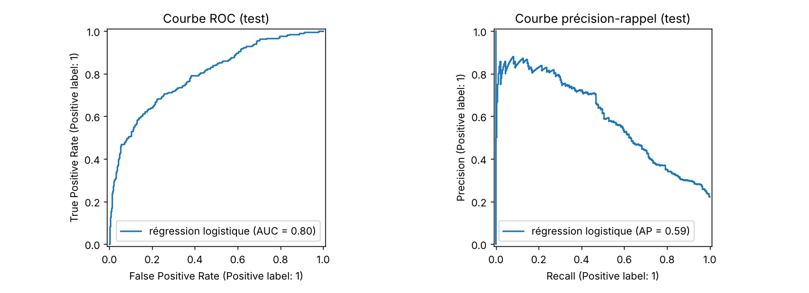
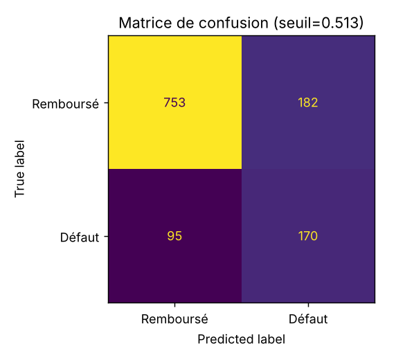
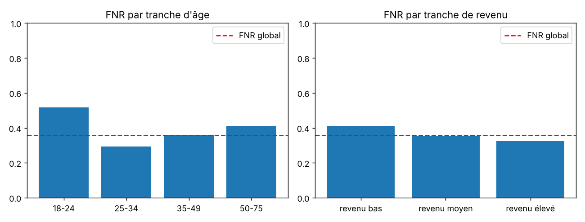

> **Statut des chiffres.** Les résultats du modèle (§6) et de non-régression (§5) proviennent de l'exécution de `scripts/run_experiments.py` et `scripts/make_baseline.py` sur le **jeu synthétique documenté** (6 000 demandes, graine 42, taux de défaut 22 %). Ils illustrent la démarche de qualification et **ne démontrent aucune performance réelle** d'un modèle de crédit. Les éléments marqués **[À COMPLÉTER]** dépendent de l'exécution sur votre machine ou sur GitHub (suite pytest complète, API, CI).

## 1. Contexte et exigences
Une institution de microfinance souhaite estimer la probabilité de défaut de remboursement d'un demandeur de crédit. Le système comprend quatre composants : validation (`validation.py`), prétraitement (`preprocessing.py`), modèle de régression logistique (`training.py`, `prediction.py`) et API FastAPI (`main.py`) exposant `GET /health`, `GET /model-info` et `POST /predict`. La réponse contient la probabilité de défaut, un niveau de risque (faible < 0,30 ≤ modéré < 0,60 ≤ élevé), des alertes éventuelles, la version du modèle et un avertissement : l'estimation est une aide à la décision, pas une décision d'octroi.

Variables d'entrée : `age` (18–75, entier), `revenu_mensuel` (> 0 FCFA), `montant_credit` (> 0 FCFA), `duree_mois` (1–120, entier), `anciennete_activite` (0–60 ans, et au plus l'âge moins 14 ans). Cible : `defaut` (1 = défaut). Le jeu est synthétique : le risque croît avec le ratio mensualité/revenu et décroît avec l'âge et l'ancienneté. Pour les moins de 25 ans, ce lien est volontairement atténué (revenus plus volatils) afin de pouvoir démontrer une analyse des faux négatifs par segment.

## 2. Stratégie de test et traçabilité
Seize exigences (EX01–EX16) sont reliées à leurs cas de test, préconditions, entrées, résultats attendus, risques et priorités dans le plan de test (Annexe A). Les sept exigences imposées (EX01–EX07) sont complétées par neuf exigences supplémentaires : champs non autorisés, montant du crédit, cohérence âge/ancienneté, corps mal formé, erreurs internes sans fuite d'information, entrées inhabituelles avec alerte, reproductibilité, performance et analyse des faux négatifs par segment.

Principe retenu : une entrée **invalide** est rejetée explicitement (422, ou 400 si le JSON est mal formé), sans jamais recopier les valeurs reçues ; une entrée **valide mais inhabituelle** (hors de la plage 1 %–99 % de l'entraînement) est traitée avec une alerte. Le modèle de test n'est pas un fichier versionné : les fixtures l'entraînent de façon déterministe (graine 42), ce qui évite les incompatibilités de sérialisation entre versions de bibliothèques et garantit un modèle maîtrisé.

Suite de tests : `test_validation`, `test_preprocessing`, `test_api`, `test_integration`, `test_robustness`, `test_properties` (Hypothesis), `test_regression`, `test_evaluation`, `test_performance`.

## 3. Tests fonctionnels et d'intégration
**Fonctionnels (API).** Les dix scénarios obligatoires sont couverts, avec le code HTTP attendu : requête valide (200), champ manquant (422), âge négatif (422), revenu en texte (422), montant nul ou négatif (422), durée non entière (422), champ supplémentaire (422), valeurs extrêmes (422), modèle indisponible (503), requête mal formée (400). Les tests vérifient le contenu des réponses (codes d'erreur, identifiant de requête, contrat de la réponse), pas seulement le code HTTP.

**Intégration.** Scénario principal : la probabilité renvoyée par l'API égale celle du pipeline appelé directement (écart ≤ 1e-12) ; la version du modèle est la même dans `/predict`, `/model-info` et les métadonnées ; la sauvegarde puis le rechargement donnent les mêmes prédictions. Scénarios d'erreur : fichier de modèle absent, corrompu ou de structure invalide (503) ; erreur de prétraitement, dimensions incompatibles avec le modèle, erreur pendant la prédiction, sortie du modèle invalide (500 générique). Dans tous ces cas, la réponse ne contient ni trace technique ni valeur reçue, et les journaux n'enregistrent que le type d'exception et l'identifiant de requête.

**Résultats d'exécution.** **[À COMPLÉTER]** : coller la sortie de `pytest --cov=app` (nombre de tests, échecs, couverture) et le lien du run GitHub Actions.

## 4. Robustesse
| Risque visé | Comportement attendu | Résultat observé | Gravité | Correction recommandée |
|---|---|---|---|---|
| Valeurs manquantes | rejet 422 `champ_manquant` | conforme (5 champs testés) | — | — |
| Valeurs non numériques (texte, null, liste, booléen) | rejet 422 `type_invalide` | conforme | — | — |
| NaN / infini (`NaN`, `Infinity` en JSON) | rejet 422 `valeur_non_finie` | conforme | — | — |
| Limites des intervalles (âge 18 et 75, durée 1 et 120, revenu 0,01) | acceptées, probabilité dans [0 ; 1] | conforme | — | — |
| Hors limites (âge 17 ou 76, revenu 1e15) | rejet 422 `hors_limites` | conforme | — | — |
| Schéma incorrect (champ en trop, corps non objet) | rejet 422 | conforme | — | — |
| Sensibilité : revenu +1 % | variation faible de la probabilité | Δ = 0,004 (seuil de test : 0,05) | — | — |
| Cohérence métier dans le domaine typique | revenu, âge, ancienneté, durée ↑ ⇒ risque ↓ ; montant ↑ ⇒ risque ↑ | conforme (5 tests) | — | — |
| Entrée valide, hors domaine d'entraînement | traitée avec alerte, sans résultat absurde | alerte présente, **mais résultat non monotone** : revenu 250 000 → 0,48 ; 800 000 → 0,29 ; 5 000 000 → **0,86 (élevé)** ; 49 000 000 → **1,00** | **Majeure** (A-R1) | borner les variables aux plages d'entraînement avant prédiction, ou renvoyer « indéterminé / revue manuelle » quand une alerte est levée |

Le test `test_far_out_of_domain_income_should_not_increase_risk` est marqué `xfail(strict=True)` : il documente l'anomalie A-R1 et échouera (XPASS) le jour où elle sera corrigée, forçant la mise à jour du test. Le test de contrat (0 ≤ p ≤ 1) passe pour ces cas, ce qui confirme qu'il ne prouve pas la robustesse.

## 5. Non-régression
**Référence figée** (`reports/baseline.json`, créée une seule fois puis versionnée, jamais recalculée par la CI).

| Élément enregistré | Valeur |
|---|---|
| Modèle | régression logistique (StandardScaler, `class_weight="balanced"`), version 1.0.0 |
| Graine / seuil de décision | 42 / 0,5135 (choisi sur la validation : précision maximale sous rappel ≥ 0,70) |
| Jeu | synthétique, 6 000 lignes ; validation : 1 200 lignes, 265 défauts |
| Version du code | « non-versionné » à la création (à régénérer après le premier commit) |
| Profils de référence | 4 demandeurs types avec leur probabilité (tolérance ±0,05) |

Tolérances fixées avant toute comparaison : baisse maximale du rappel de 0,05, du F1 de 0,05, de la ROC-AUC de 0,03.

| Version comparée | Rappel | F1 | ROC-AUC | Verdict |
|---|---|---|---|---|
| Référence (validation, seuil figé) | 0,702 | 0,617 | 0,829 | — |
| Version courante (même code) | 0,702 | 0,617 | 0,829 | **Acceptée** (écart nul) |
| Modèle volontairement dégradé (étiquettes mélangées) | 0,283 | 0,262 | 0,534 | **Rejetée** : les trois critères sont franchis |

Le contrôle de ce contrôle (modèle dégradé détecté) prouve que la non-régression sait échouer. Les tests vérifient aussi la stabilité des profils de référence, le contrat de la réponse (clés inchangées), la reproductibilité de l'entraînement et l'identité des prédictions après sauvegarde et rechargement.

## 6. Performance du modèle et équité
Seuil retenu 0,513 (choisi sur la validation). Jeu de test : 1 200 demandes, 265 défauts.

| Jeu | Précision | Rappel | F1 | ROC-AUC | PR-AUC | FPR | FNR |
|---|---|---|---|---|---|---|---|
| Entraînement | 0,525 | 0,642 | 0,578 | 0,821 | 0,622 | 0,165 | 0,358 |
| Validation | 0,550 | 0,702 | 0,617 | 0,830 | 0,623 | 0,163 | 0,298 |
| **Test** | **0,483** | **0,642** | **0,551** | **0,797** | **0,593** | **0,195** | **0,358** |

Matrice de confusion (test) : 170 défauts détectés, 95 manqués (faux négatifs), 182 faux positifs, 753 remboursements corrects. Intervalles à 95 % (Wilson) : rappel 0,642 [0,582 ; 0,697], FNR 0,358 [0,303 ; 0,418]. Le rappel est inférieur au 0,70 visé sur la validation : un écart de 6 points entre validation et test, signe de la variance d'estimation (anomalie A-M2). Pas de surapprentissage : les performances d'entraînement et de test sont comparables.

{width=15cm}

{width=9cm}

**Faux négatifs par segment (test).**

| Segment | n | Défauts | Rappel | FNR | FPR |
|---|---|---|---|---|---|
| 18–24 ans | 126 | 29 | 0,483 | **0,517** [0,344 ; 0,686] | 0,433 |
| 25–34 ans | 314 | 85 | 0,706 | 0,294 | 0,236 |
| 35–49 ans | 601 | 129 | 0,643 | 0,357 | 0,148 |
| 50–75 ans | 159 | 22 | 0,591 | 0,409 | 0,117 |
| Revenu bas | 400 | 76 | 0,592 | 0,408 | 0,170 |
| Revenu moyen | 400 | 93 | 0,645 | 0,355 | 0,195 |
| Revenu élevé | 400 | 96 | 0,677 | 0,323 | 0,220 |

{width=15cm}

Les 18–24 ans cumulent un FNR de 51,7 % (15,9 points au-dessus du FNR global) **et** un FPR de 43,3 % : le modèle manque plus de défauts dans ce groupe et refuse à tort davantage de bons payeurs. Les effectifs sont faibles (29 défauts), donc l'intervalle est large, mais l'écart dépasse le critère de 15 points du plan. Ce résultat est cohérent avec la construction du jeu (signal atténué pour les moins de 25 ans) : il sert ici à démontrer la méthode d'analyse, pas à décrire une population réelle.

## 7. Performance de l'API
**Protocole.** Inférence isolée (hors HTTP) : 300 prédictions après échauffement, `time.perf_counter`. Requête API : `TestClient` FastAPI en processus (HTTP simulé, sans réseau, validation incluse), 300 requêtes isolées puis charge progressive à 1, 2, 4 et 8 clients simultanés (100 requêtes chacun) ; une charge réseau réelle est possible avec Locust (`scripts/locustfile.py`). Machine : Intel Core i7-14650HX (24 processeurs logiques), 16 Go de RAM, Windows, Python 3.13 (à confirmer).

**Objectifs justifiés.** Un agent de crédit saisit une demande puis attend le résultat : une réponse sous 200 ms au P95 reste imperceptible, et l'inférence seule doit rester sous 20 ms pour laisser de la marge au traitement HTTP. Débit minimal visé : 20 requêtes/s en séquentiel, largement supérieur au volume d'une agence.

| Mesure | Objectif | Résultat |
|---|---|---|
| Latence d'inférence P95 (prédiction isolée) | < 20 ms | **[À COMPLÉTER]** (indicatif en conteneur Linux : P50 2,1 ms, P95 2,8 ms) |
| Latence API P95 (requête isolée) | < 200 ms | **[À COMPLÉTER]** (`scripts/perf_report.py`) |
| Débit séquentiel | > 20 req/s | **[À COMPLÉTER]** |
| Charge progressive 1 → 8 clients | latence P95 stable | **[À COMPLÉTER]** (tableau de `reports/perf.md`) |
| Taille du modèle | < 200 Ko | **[À COMPLÉTER]** (quelques Ko attendus) |

## 8. Registre des anomalies
| ID | Anomalie | Gravité | Statut / correction |
|---|---|---|---|
| A-R1 | Extrapolation hors domaine : un revenu très élevé augmente le risque (revenu 5 000 000 → 0,86 « élevé ») | Majeure | Ouverte ; test `xfail` strict ; borner les entrées ou « revue manuelle » si alerte |
| A-M1 | FNR des 18–24 ans = 0,517 (+15,9 points vs global) et FPR = 0,433 | Majeure | Ouverte ; données et variables à enrichir, analyse d'équité sur données réelles |
| A-M2 | Rappel de test 0,642 contre 0,702 en validation (variance d'estimation) | Moyenne | Ouverte ; validation croisée, intervalles de confiance |
| A-V1 | Une durée écrite `12.0` est rejetée (typage strict des entiers) | Mineure | À documenter dans le contrat ou à assouplir |
| A-P1 | `/predict` est asynchrone mais l'inférence est synchrone : elle bloque la boucle d'événements en forte charge | Mineure | Exécuter l'inférence dans un pool de threads |
| A-C1 | Aucune authentification de l'API | Mineure | Hors périmètre du prototype ; à prévoir avant tout usage |
| A-D1 | Données synthétiques : aucune conclusion sur la performance réelle | Majeure (limite) | Inhérente ; évaluation sur données réelles requise |
| A-T1 | Défauts éventuels révélés par la première exécution de la suite complète | — | **[À COMPLÉTER]** |

## 9. Limites de l'évaluation
Données synthétiques ; critères d'acceptation choisis en connaissant l'ordre de grandeur des résultats (ils illustrent la démarche et n'ont pas de valeur métier) ; effectifs faibles dans certains segments (29 défauts chez les 18–24 ans) ; partition aléatoire et non temporelle ; mesures de performance en processus (sans réseau ni base de données) ; aucun test de sécurité avancé (authentification, limitation de débit) ; l'équité n'est analysée que sur l'âge et le revenu, alors que l'usage de l'âge dans une décision de crédit peut être encadré juridiquement.

## 10. Recommandations
1. Corriger A-R1 : borner les variables aux plages d'entraînement (ou traiter toute alerte comme une revue manuelle) et retirer le `xfail` une fois le test au vert.
2. Analyser les erreurs par segment sur données réelles, avec intervalles de confiance, et définir un FNR maximal acceptable par segment avec le métier et les services juridiques.
3. Choisir le seuil à partir du coût réel d'un faux négatif (perte sur un crédit) et d'un faux positif (client légitime refusé), par validation croisée.
4. Maintenir un humain dans la boucle : l'API fournit une aide à la décision, avec l'avertissement déjà intégré à la réponse.
5. Ajouter authentification, limitation de débit, journalisation d'audit sans données personnelles, et supervision (dérive des données, taux d'alertes, performances sur labels retardés).
6. Régénérer la baseline après le premier commit pour enregistrer la version du code.

## 11. Conclusion sur l'aptitude à un pilote
Verdict établi sur le jeu de test synthétique. ROC-AUC (0,797), rappel global (0,642) et F1 (0,551) respectent les critères du plan ; les entrées invalides sont toutes rejetées et la non-régression est opérationnelle. En revanche, le FNR des 18–24 ans dépasse de 15,9 points le FNR global (critère : 15 points) et l'anomalie majeure A-R1 n'est pas corrigée. **Décision : investiguer avant tout pilote** ; un pilote en mode « aide à la décision, sans effet automatique » ne serait envisageable qu'après correction de A-R1, analyse d'équité sur données réelles et validation métier. La validation technique ne vaut pas décision métier : elle ne prouve ni l'équité, ni la conformité réglementaire, ni l'adéquation à une décision de crédit réelle.

## 12. Question de synthèse
**Tous les tests fonctionnels et techniques réussissent, mais le modèle présente un taux élevé de faux négatifs pour certains profils. Peut-on recommander sa mise en production ? Non.**

- **Les tests ne mesurent pas la même chose.** Ils prouvent que le système fait ce qu'il est spécifié à faire (valider, prédire, signaler les erreurs) ; ils ne prouvent pas que ce qu'il prédit est juste pour tous. Ici, tous les tests peuvent passer alors que le FNR des 18–24 ans atteint 51,7 %.
- **Le coût d'un faux négatif est élevé et inégalement réparti.** Un défaut non détecté, c'est un crédit accordé à un emprunteur qui ne remboursera pas : perte pour l'institution et surendettement pour l'emprunteur. Un groupe sur-représenté parmi les faux négatifs porte ce risque de façon disproportionnée ; le FPR élevé du même groupe (43,3 %) ajoute le risque inverse, le refus de bons payeurs.
- **Le risque est aggravé par l'usage de l'âge**, variable dont l'emploi dans une décision de crédit peut être juridiquement encadré ; une disparité de performance entre groupes peut engager la responsabilité de l'institution.
- **Conditions minimales avant une mise en production :** analyse des erreurs par segment sur données réelles avec incertitudes ; seuils d'équité et de coût définis par le métier ; mesures correctives (données, variables, seuil, revue manuelle des profils à risque) puis nouvelle qualification ; décision humaine finale ; supervision continue des taux d'erreur par segment après déploiement ; validation juridique et conformité.
- **Position défendable :** poursuivre en phase d'essai encadrée (mode ombre, sans effet sur les décisions) pour collecter des données réelles et mesurer les erreurs par segment, sans mise en production.
